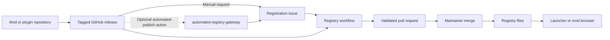

# Zero Infra Mod Registry

A Git-backed registry for pak mods and native DLL plugins. GitHub releases host
the assets; a registry repository stores metadata, dependency versions, download
URLs, hashes and sizes. GitHub Actions validate registration requests and open
approval pull requests. Clients read the committed indexes and package files.

## Architecture



Publishers commit `mod.json` or `plugin.json` before tagging. A metadata file
uploaded as a release asset overrides the file at the tag. Registration retrieves
only the requested release, checks dependencies, and generates database entries.
Pak assets are scanned for manifests; DLL assets are downloaded for SHA-256 and
size checks. Existing versions cannot be overwritten.

Registry layout:

```text
registry/                                  repository records and redirects
package_db/mod_list_index.txt              pak package index (owner/repository)
package_db/packages/<owner>/<repo>.json     pak releases and manifests
dll_db/plugin_list_index.txt               plugin index (owner/repository)
dll_db/packages/<owner>/<repo>.json         plugin releases and DLL metadata
```

The registry processes issues into pull requests. Maintainers approve each
release by merging. Optional publishing workflows merge validated snapshots into
consumer branches such as `db`. Clients fetch indexes, then individual package
files and assets from their recorded URLs. DLL approval requires code review;
hashes only verify download integrity.

The optional Python `automated-registry-gateway` authenticates publisher Actions
with GitHub OIDC and creates issues through a GitHub App. Its private key stays on
your HTTPS server; `/data` stores request and rate-limit records. Publishers can
open issues manually or use the optional `automated-publish` action.
See [gateway setup](docs/registry/automated-registry-gateway.md).

## GitHub automation

| Action or reusable workflow | Purpose | Setup |
|---|---|---|
| Root action | Register, remove, or validate registry entries in Docker | [Registry actions](docs/registry/actions.md) |
| `actions/validate-metadata` | Check metadata schemas and registered dependency versions | [Plugins](docs/plugin/README.md), [mods](docs/mod/README.md) |
| `actions/automated-publish` (optional) | Submit a release through OIDC or a direct issue token | [Automated publish](docs/plugin/release-requests.md) |
| `actions/publish-branch` | Prepare an immutable merge candidate for validated publication | [Publishing](docs/registry/publishing.md) |
| `.github/workflows/register-release.yml` | Parse issues, register releases, validate, open approval PRs | [Registry setup](docs/registry/README.md) |
| `.github/workflows/validate-registry.yml` | Validate registry PRs, including DLL downloads | [Registry setup](docs/registry/README.md) |
| `.github/workflows/publish-registry.yml` | Validate and publish to a consumer branch | [Publishing](docs/registry/publishing.md) |
| `.github/workflows/publish-automated-registry-gateway.yml` | Test and publish the optional Python gateway image to GHCR | [Gateway setup](docs/registry/automated-registry-gateway.md#image-publication) |

Start with [registry setup](docs/registry/README.md), [plugin setup](docs/plugin/README.md),
or [mod setup](docs/mod/README.md). Examples use branch references; pin production
references to a commit SHA. The new automated components target `prepare-v1`.
For reusable workflows, pin `tool_ref` to the same SHA.

## GitHub App setup (optional gateway)

Manual registration needs no App. For `automated-registry-gateway`, create an App
under your registry owner's **Settings → Developer settings → GitHub Apps → New
GitHub App**. The App creates issues; publishers authenticate with GitHub OIDC,
not OAuth. Publisher repositories do not install the App.

| Setting | Value |
|---|---|
| GitHub App name | A unique name, such as `my-registry-gateway` |
| Homepage URL | Your registry repository or project website |
| Callback URL / redirect URI | Empty |
| Expire user authorization tokens | Disabled; user tokens are unused |
| Request user authorization (OAuth) during installation | Disabled |
| Enable Device Flow | Disabled |
| Setup URL | Empty |
| Redirect on update | Disabled |
| Webhook → Active | Disabled |
| Webhook URL and secret | Empty |
| Repository permissions → Issues | Read and write |
| Repository permissions → Metadata | Read-only; automatic |
| All other repository, organization and account permissions | No access |
| Subscribe to events | None |
| Where can this GitHub App be installed? | Only on this account |

Then:

1. Create the App and record its **App ID** as `GITHUB_APP_ID` (not its Client ID).
2. Select **Install App**, install on the registry owner, choose **Only select
   repositories**, and select only the registry repository.
3. Record the installation ID from the installation settings URL
   (`.../installations/<id>`) as `GITHUB_INSTALLATION_ID`.
4. Under the App's **Private keys**, generate an RSA key. Store the downloaded PEM
   only on the gateway server; never commit it or share it with publishers. Mount
   it using `GITHUB_PRIVATE_KEY_FILE`, readable by container UID 10001.
5. Enable Issues and the [registration workflow](docs/registry/README.md#process-issues)
   on the registry. Under **Settings → Actions → General**, enable
   **Allow GitHub Actions to create and approve pull requests**. Maintainers still
   review and merge approval PRs.
6. Configure the gateway with those IDs, `REGISTRY_REPOSITORY`, and
   `GATEWAY_AUDIENCE=https://YOUR-HOST/registrations`. The audience is the public
   HTTPS endpoint, not an OAuth callback or webhook. Follow
   [server configuration and deployment](docs/registry/automated-registry-gateway.md#server-configuration).

App-created issues trigger the registry workflow without webhook subscriptions.
The gateway requests installation tokens restricted to Issues write on the fixed
registry repository. Issues write does not grant code push or PR merge access,
but issue-triggered workflows must still treat requests as untrusted input.

**Protect the private key:** it can mint tokens for every installation of the
App. Choosing **Any account** permits other owners to install it; it does not
grant automatic access, but each installation expands the impact of key theft.
Use **Only on this account** unless other registry owners need the App. Restrict
each installation to its registry repository. Rotate a compromised key and
revoke existing installation tokens; key rotation alone does not revoke them.

App installation scope and publisher enrollment are independent. Set
`ALLOWED_REPOSITORY_IDS` to permitted public publisher IDs; empty allows any
public repository to request registration. Maintainer approval remains required.

## Local development

The uv workspace builds three packages: the registry, gateway, and shared core.
See [package layout](docs/development.md).

```sh
uv sync --all-groups
uv build --all-packages
uv run mypy .
uv run pytest .
node --test actions/automated-publish/*.test.cjs
bash tests/actions/test-publish-branch.sh
```

Python 3.12+ is required. Docker and CI use Python 3.14. Pak registration also
requires [UnchainedScanner](https://github.com/Chiv2-Community/UnchainedLauncher);
the Docker image includes it. See [CLI usage](docs/registry/actions.md#cli).

[License](LICENSE)
