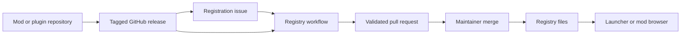

# Zero Infra Mod Registry

A Git-backed registry for pak mods and native DLL plugins. GitHub releases host
the assets; a registry repository stores metadata, dependency versions, download
URLs, hashes and sizes. GitHub Actions validate registration requests and open
approval pull requests. Clients read the committed indexes and package files.

## Architecture



Publishers commit `mod.json` or `plugin.json` before tagging. A metadata file
uploaded as a release asset overrides the file at the tag. Registration retrieves
only the requested release, checks dependencies, and generates database entries.
Pak assets are scanned for manifests; DLL assets are downloaded for SHA-256 and
size checks. Existing versions cannot be overwritten.

Registry layout:

```text
registry/                                  repository records and redirects
package_db/mod_list_index.txt              pak package index (owner/repository)
package_db/packages/<owner>/<repo>.json     pak releases and manifests
dll_db/plugin_list_index.txt               plugin index (owner/repository)
dll_db/packages/<owner>/<repo>.json         plugin releases and DLL metadata
```

The registry processes issues into pull requests. Maintainers approve each
release by merging. Optional publishing workflows merge validated snapshots into
consumer branches such as `db`. Clients fetch indexes, then individual package
files and assets from their recorded URLs. DLL approval requires code review;
hashes only verify download integrity.

## GitHub automation

| Action or reusable workflow | Purpose | Setup |
|---|---|---|
| Root action | Register, remove, or validate registry entries in Docker | [Registry actions](docs/registry/actions.md) |
| `actions/validate-metadata` | Check metadata schemas and registered dependency versions | [Plugins](docs/plugin/README.md), [mods](docs/mod/README.md) |
| `actions/request-release` | Verify a published asset and create/reuse a registration issue | [Release requests](docs/plugin/release-requests.md) |
| `actions/publish-branch` | Merge an immutable approved snapshot into an existing branch | [Publishing](docs/registry/publishing.md) |
| `.github/workflows/register-release.yml` | Parse issues, register releases, validate, open approval PRs | [Registry setup](docs/registry/README.md) |
| `.github/workflows/validate-registry.yml` | Validate registry PRs, including DLL downloads | [Registry setup](docs/registry/README.md) |
| `.github/workflows/publish-registry.yml` | Validate and publish to a consumer branch | [Publishing](docs/registry/publishing.md) |

Start with [registry setup](docs/registry/README.md), [plugin setup](docs/plugin/README.md),
or [mod setup](docs/mod/README.md). Examples use `@main`; pin production references
to a commit SHA. For reusable workflows, set `tool_ref` to the same SHA to pin the
implementation checkout too.

## Local development

```sh
uv sync --all-groups
uv run mypy .
uv run pytest .
node --test actions/request-release/*.test.cjs
bash tests/actions/test-publish-branch.sh
```

Python 3.12+ is required. Docker and CI use Python 3.14. Pak registration also
requires [UnchainedScanner](https://github.com/Chiv2-Community/UnchainedLauncher);
the Docker image includes it. See [CLI usage](docs/registry/actions.md#cli).

[License](LICENSE)
