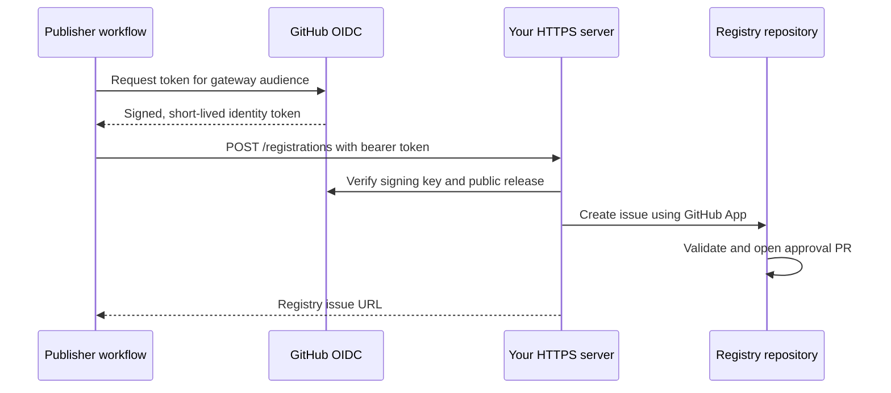

# automated-registry-gateway

`automated-registry-gateway` is an optional Python service. It verifies a public
publisher's GitHub OIDC identity and release, then creates a registry issue using
a GitHub App. The issue workflow opens an approval PR for maintainer review.

Use it with optional `actions/automated-publish` for automatic release requests.
Publishers need no registry token. Manual registration issues work without either.

Its Python package is a separate [uv workspace member](../development.md).
The image installs only gateway dependencies and shared core.



Identity comes from signed claims. Allowed events: `push`, `release`, and
`workflow_dispatch` at a public repository tag. The tag must match the token and
current commit; repository and owner IDs must match GitHub. Enrollment can
restrict access by immutable repository ID.

## Create the GitHub App

1. Under your GitHub account or organization settings, create a GitHub App.
2. Set its name and homepage URL. Disable **Active** under Webhook.
3. Grant **Repository permissions → Issues: Read and write**. Metadata read access
   is automatic.
4. Install it on the registry owner, selecting **only the registry repository**.
5. Record the App ID from the App settings and installation ID from the installed
   App's URL (`.../installations/<id>`).
6. Generate and download an RSA private key. Store it only on your server.
7. Enable the registry's [issue workflow](README.md#process-issues) and Actions PR
   creation setting.

App-created issues trigger the issue workflow.

## Server configuration

Run one gateway per registry. Persist `/data` on local storage for the request
ledger, rate limits and process lock. Atomic writes and filesystem locks preserve
deduplication across restarts. Independent replicas are unsupported.

| Variable | Example | Default | Description |
|---|---|---|---|
| `GATEWAY_AUDIENCE` | `https://registry.example.com/registrations` | Required | Exact public endpoint URL; HTTPS, `/registrations`, no query or credentials |
| `REGISTRY_REPOSITORY` | `Chiv2-Community/C2ModRegistry` | Required | Fixed destination owner/repository |
| `GITHUB_APP_ID` | `123456` | Required | Numeric App ID |
| `GITHUB_INSTALLATION_ID` | `789012` | Required | Numeric installation ID on the registry owner |
| `GITHUB_PRIVATE_KEY_FILE` | `/run/secrets/github-app.pem` | Required | Mounted RSA private key; readable by UID 10001 |
| `GATEWAY_STATE_DIRECTORY` | `/data` | `/data` | Persistent directory writable by UID 10001 |
| `ALLOWED_REPOSITORY_IDS` | `321,654` | Empty | Comma-separated enrolled repository IDs; empty accepts any public repository |
| `REQUESTS_PER_HOUR` | `5` | `20` | New request attempts per repository per hour |
| `GLOBAL_REQUESTS_PER_HOUR` | `10` | `10` | New request attempts across all publishers per hour |
| `GITHUB_PUBLIC_READ_TOKEN` | Server-side read token | Empty | Optional token for public GitHub API reads at higher volumes |
| `GATEWAY_HOST` | `0.0.0.0` | `0.0.0.0` | Container listen address |
| `GATEWAY_PORT` | `8080` | `8080` | Container listen port; keep 8080 for supplied Compose and health check |
| `GATEWAY_IMAGE` | `ghcr.io/chiv2-community/automated-registry-gateway:sha-<full-sha>` | `...:prepare-v1` | Compose image override; export in the shell or put in Compose's `.env` |

Each registration uses three public GitHub API reads. Unauthenticated reads are
limited to 60/hour/IP; set `GITHUB_PUBLIC_READ_TOKEN` for higher volumes. Registry
issue operations use the App token scoped to Issues write on one repository.

For an enrolled repository, obtain its immutable ID with
`gh api repos/Owner/Plugin --jq .id` and add it to `ALLOWED_REPOSITORY_IDS`.

## Deploy with Docker Compose

Copy `automated-registry-gateway/compose.yml` and
`automated-registry-gateway/gateway.env.example` from this repository
into a directory on your server. Put the downloaded key there as `github-app.pem`.
Do not commit keys or populated environment files.

```sh
cp gateway.env.example gateway.env
# Edit gateway.env: audience, registry, App ID and installation ID.
chmod 0600 gateway.env
sudo chown 10001:10001 github-app.pem
sudo chmod 0400 github-app.pem
docker compose config --quiet
docker compose up -d
curl --fail http://127.0.0.1:8080/healthz
```

The image runs as UID/GID 10001 with a read-only filesystem and dropped
capabilities. Compose persists state and binds loopback port 8080. Run the HTTPS
proxy on that host or connect through a private Docker network.

For production, export `GATEWAY_IMAGE` with a published commit tag or image digest
before running Compose. The first GHCR package publication is private by default;
set package visibility to **Public** or authenticate your server to GHCR.

## HTTPS proxy

Use a public HTTPS hostname with a trusted certificate. Forward `/registrations`
to `127.0.0.1:8080`, preserve Authorization, and disable caching. Limit request
bodies to 16 KiB, allow bearer-token headers up to 16 KiB, limit concurrent
connections, and use an upstream response timeout of at least 90 seconds.

Example Nginx settings, inside the `http` block:

```nginx
limit_req_zone $binary_remote_addr zone=gateway_requests:10m rate=2r/s;
limit_conn_zone $server_name zone=gateway_connections:1m;
```

Inside your existing TLS-enabled `server` block:

```nginx
client_max_body_size 16k;
client_header_timeout 15s;
client_body_timeout 15s;
large_client_header_buffers 4 16k;

location = /registrations {
    limit_req zone=gateway_requests burst=10 nodelay;
    limit_conn gateway_connections 16;
    limit_req_status 429;
    limit_conn_status 429;
    proxy_pass http://127.0.0.1:8080;
    proxy_set_header Authorization $http_authorization;
    proxy_read_timeout 120s;
    proxy_connect_timeout 5s;
}
```

Keep the HTTP backend private behind the bounded HTTPS proxy. Exclude Authorization
headers and request bodies from logs. Allow outbound HTTPS to `api.github.com`
and `token.actions.githubusercontent.com`.

## Publisher workflow

The action obtains an OIDC token for the exact endpoint, masks it, and submits
release details. Configure `id-token: write` and run from the published tag.

| Input | Example | Default | Description |
|---|---|---|---|
| `endpoint` | `https://registry.example.com/registrations` | Empty | Exact gateway URL and OIDC audience |
| `kind` | `plugin` | Required | `plugin` for DLLs or `mod` for pak assets |
| `release_tag` | `${{ github.ref_name }}` | `github.ref_name` | Published semantic version tag; must match the workflow tag |
| `asset_name` | `Plugin.dll` | Empty | Exact asset filename; required for multiple DLLs |

```yaml
request-registration:
  needs: publish-release
  runs-on: ubuntu-latest
  permissions:
    contents: read
    id-token: write
  concurrency:
    group: registry-release-${{ github.ref }}
    cancel-in-progress: false
  steps:
    - uses: Chiv2-Community/zero-infra-mod-registry/actions/automated-publish@prepare-v1
      with:
        endpoint: https://registry.example.com/registrations
        kind: plugin
        asset_name: Plugin.dll
```

Replace `publish-release` with your publishing job; pin the action to a commit.
OIDC uses the workflow repository and gateway's fixed registry. Supply `endpoint`
or `registry_token`, never both. Token-based callers can omit `endpoint`.

## Image publication

`.github/workflows/publish-automated-registry-gateway.yml` runs gateway tests,
strict mypy and a Docker smoke test, then publishes amd64/arm64 images built from
`automated-registry-gateway/Dockerfile` to
`ghcr.io/<owner>/automated-registry-gateway`. It uses the repository's `GITHUB_TOKEN`
with Packages write permission.

| Trigger | Published tags | Description |
|---|---|---|
| Push to `prepare-v1` | `prepare-v1`, `sha-<full-sha>` | Integration build |
| Push to `main` | `main`, `latest`, `sha-<full-sha>` | Main-branch build |
| Push tag `v*` | Exact tag, `sha-<full-sha>` | Versioned image |
| Manual dispatch | Branch/tag and `sha-<full-sha>` | Rebuild the selected revision |

Allow Actions to write packages. Existing packages must grant this repository
Actions access. PR CI builds and smoke-tests the image without publishing it.

Local build and tests:

```sh
docker build -f automated-registry-gateway/Dockerfile -t automated-registry-gateway:local .
bash tests/actions/test-gateway-image.sh automated-registry-gateway:local
uv run pytest tests/test_gateway.py
uv run mypy .
```

## Operations and errors

`GET /healthz` checks HTTP liveness. `automated-registry-gateway --check-config`
checks configuration and key format. Test App permissions with a real tagged request.

| HTTP status | Meaning | Resolution |
|---|---|---|
| `200` | Created or reused issue | Read `issue_url` |
| `400` / `413` / `415` | Invalid payload, oversized body or content type | Use the shared action |
| `401` | Invalid, expired or unauthorized OIDC identity | Check `id-token: write`, exact audience, public visibility, tag event and enrollment |
| `403` | Tag, repository owner/ID or commit mismatch | Run from the publisher's published tag; do not move release tags |
| `409` | Conflicting request or reused token after a failed attempt | Edit the existing issue or rerun the action for a fresh token |
| `422` | Missing/unpublished release or invalid asset selection | Publish/upload the asset; select its exact filename |
| `429` | Persistent gateway rate limit reached | Wait for the rolling hour window or adjust server limits |
| `502` / `503` | GitHub API, App configuration or state storage failure | Check permissions, API quotas, outbound access and writable persistent storage |

Duplicates return the original issue URL, including closed issues. Failed attempts
count toward limits and consume the token; rerun for a fresh token. GitHub issue
history recovers requests lost between issue creation and local persistence.

Back up `/data` and the App configuration. Keep the App key separately protected.
Rotate it by generating a new key, replacing the mounted file, recreating the
container, then revoking the old key. Keep publisher code off the gateway;
maintainers review mod and DLL safety.
